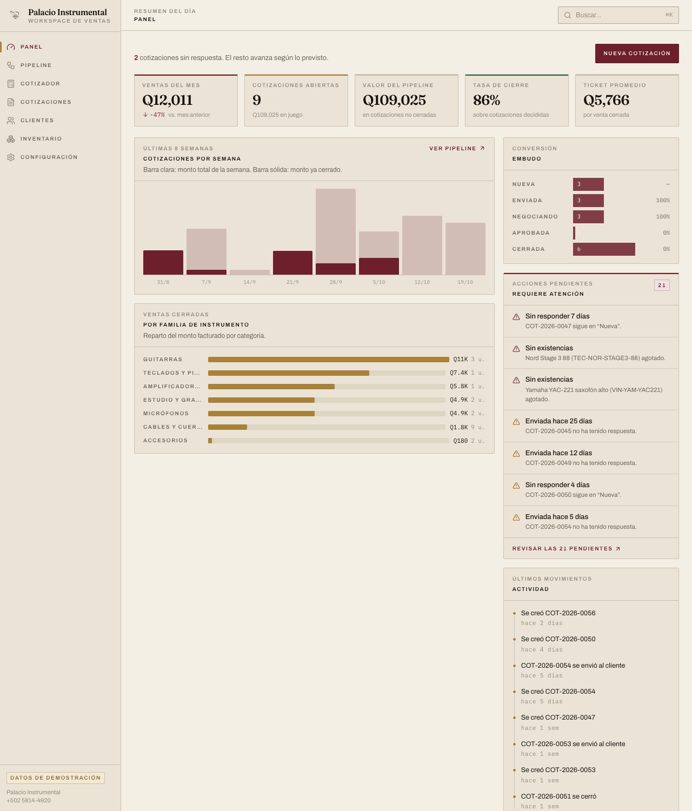
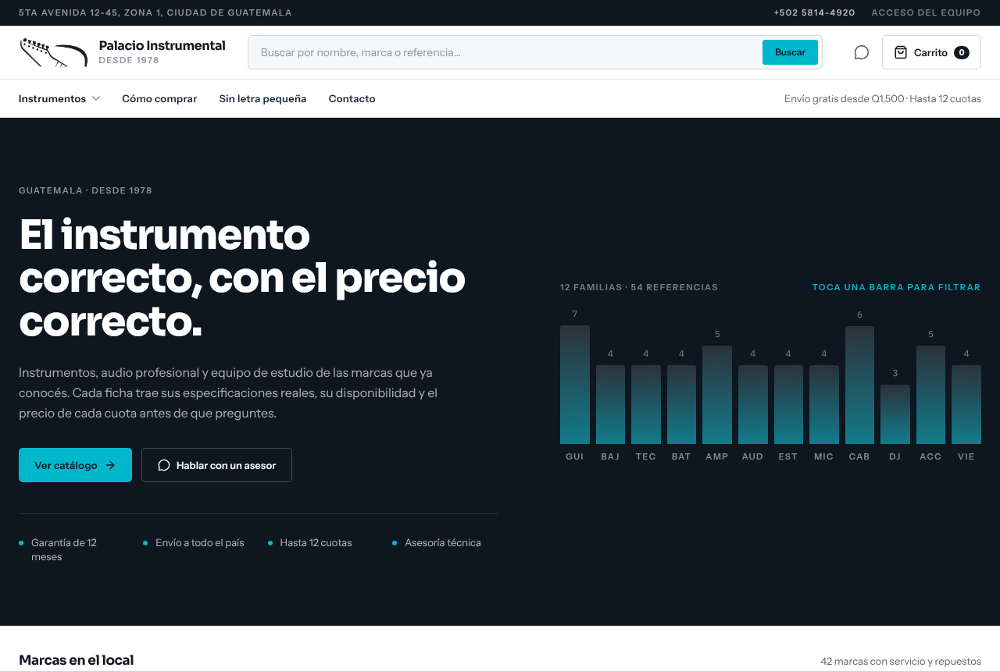
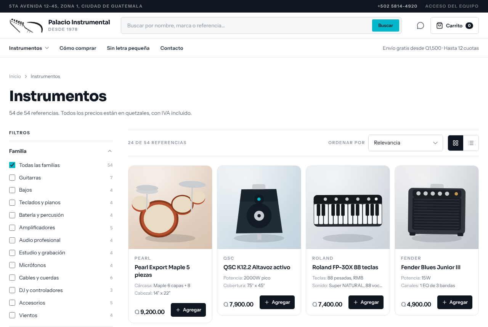
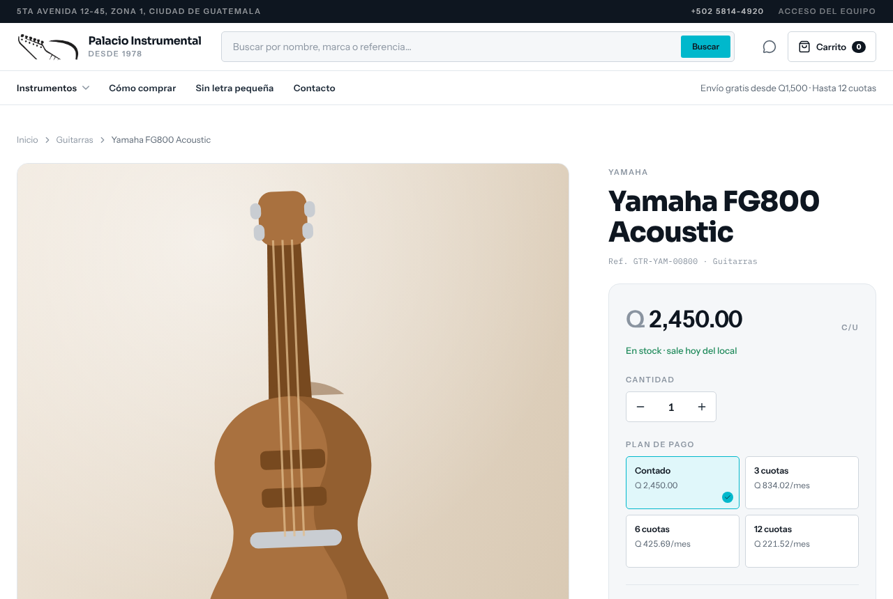
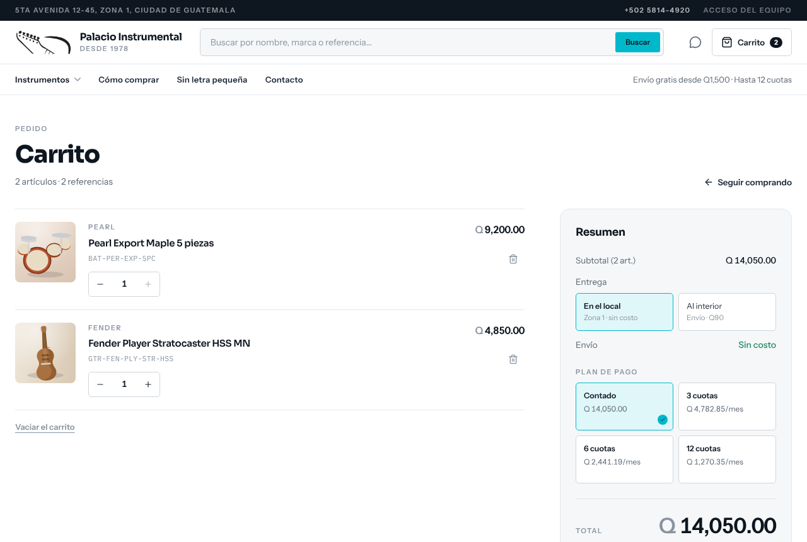
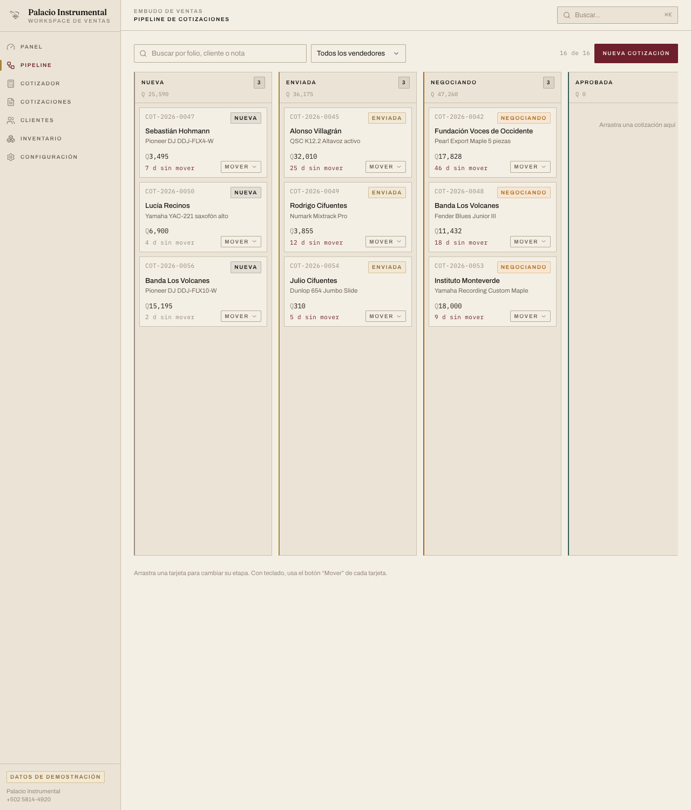
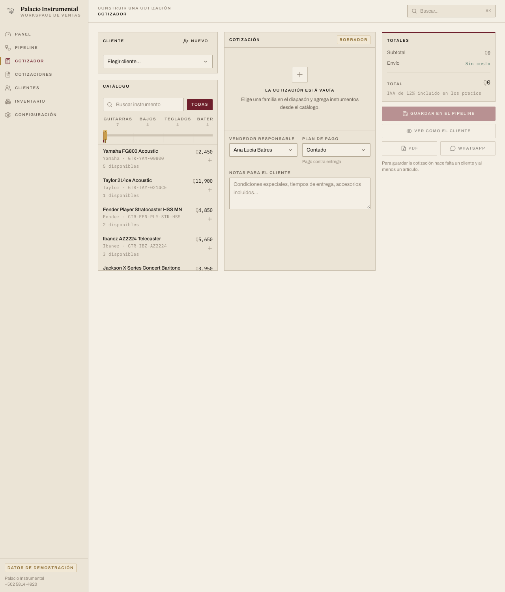
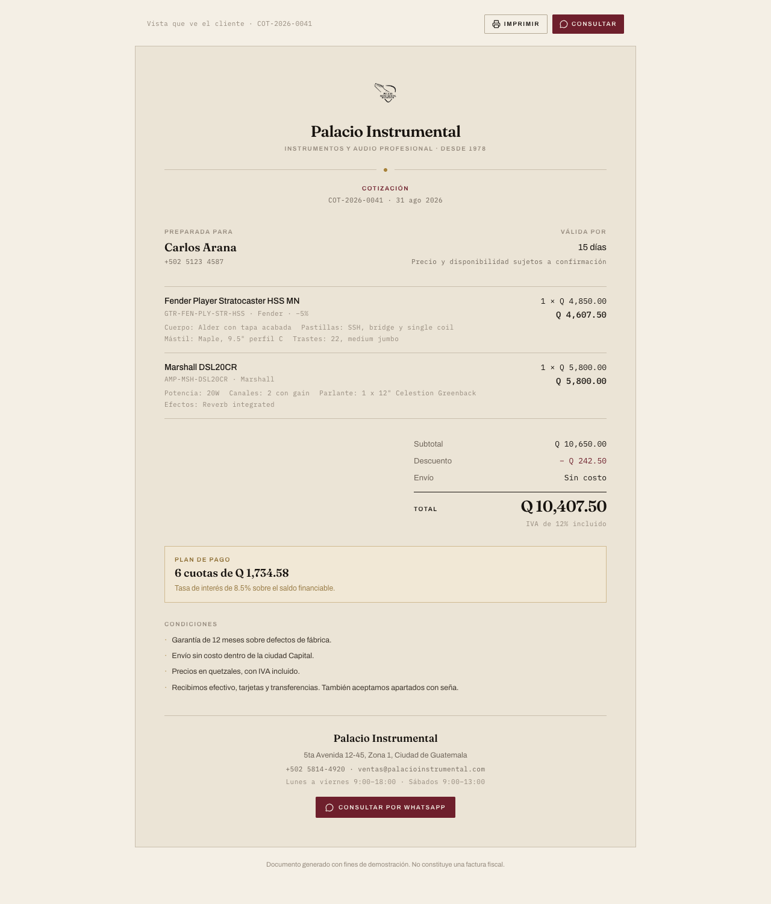

# Palacio Instrumental — Workspace de Ventas + Tienda

Dos aplicaciones en una sola:

- **La tienda** (`/`) — lo que ve el cliente: catálogo completo, fichas
  técnicas, carrito y cierre por WhatsApp.
- **El workspace** (`/crm`) — lo que ve el equipo de ventas: pipeline de
  cotizaciones, clientes, cotizador con PDF e inventario.

Es una **aplicación de demostración**: los datos viven en el navegador
(`localStorage`), con un catálogo, una cartera y un pipeline de ejemplo. No hay
servidor ni base de datos.



---

## Guion de demo

### Parte 1 — La tienda (lo que ve el cliente)

| # | Pantalla | Qué mostrar | Qué decir |
|---|---|---|---|
| 1 | **Portada** `/` | El titular, la **lista de precios** que hace de póster y el panel **"Sin letra pequeña"** | *“Las dos tiendas de referencia no dicen ni una palabra de cuotas, garantía o envío en su portada. Nosotros sí: el cliente decide con todos los números a la vista.”* |
| 2 | **El medidor** | En la portada, las 12 barras tipo VU: la altura de cada una es la cantidad real de artículos de esa familia, y al tocarla filtra el catálogo | *“La forma del catálogo es la navegación. Cada barra es un dato y un filtro a la vez.”* |
| 3 | **Catálogo** `/catalogo` | Los 54 artículos en tarjetas con imagen, cinta de estado (Agotado / Novedad), dos especificaciones y precio; vista en cuadrícula o lista | *“Cada artículo muestra sus especificaciones reales. No es una foto con un precio: es la ficha.”* |
| 4 | **Filtros** | Buscador grande de la cabecera; barra lateral con familia, marca, precio y disponibilidad (con contadores); en móvil, en un panel deslizable | *“El cliente encuentra lo que busca sin pedirle ayuda a nadie.”* |
| 5 | **Ficha de producto** | La tabla de especificaciones completa, la disponibilidad, el selector de **plan de pago** y el total | *“Y antes de comprar, el cliente ya sabe cuánto va a pagar cada mes.”* |
| 6 | **Carrito** `/carrito` | Agregar dos o tres artículos, cambiar cantidades, elegir el plan y ver el total con el envío calculado | *“El carrito calcula el envío y muestra el precio por cuota antes de que el cliente pregunte.”* |
| 7 | **Cierre** | Botón **"Confirmar por WhatsApp"** | *“El pedido llega al asesor con los precios, el plan de pago y el envío ya resueltos. Así empieza la conversación con datos, no con '¿cuánto cuesta?'”* |

### Parte 2 — El workspace (lo que ve el equipo)

Entra por **`/crm`**, o desde el enlace discreto **Acceso del equipo** de la franja
superior de la tienda. El botón **TIENDA** del workspace devuelve a la tienda pública.

| # | Pantalla | Qué mostrar | Qué decir |
|---|---|---|---|
| 1 | **Panel** | 5 indicadores, el embudo con su % de conversión, el gráfico de 8 semanas y **"Requiere atención"** | *“Aquí el equipo sabe en qué está. Las cotizaciones sin respuesta y el stock bajo salen solos, con su enlace para resolverlas.”* |
| 2 | **Pipeline** | Arrastrar una tarjeta de “Negociando” a “Cerrada”. Con teclado: el botón **Mover** de cada tarjeta | *“El embudo es el mismo para todos. Si no puedes arrastrar, el botón Mover hace lo mismo.”* |
| 3 | **Cotizador** | Elegir cliente, moverse por el **diapasón**, agregar instrumentos, cambiar cantidad y descuento, plan de 6 meses, **PDF** y **WhatsApp** | *“De la cotización al WhatsApp del cliente en un clic. Y el PDF sale con el escudo y las condiciones.”* |
| 4 | **Vista del cliente** `/cotizacion/:id` | La cotización renderizada como documento | *“Esto es lo que recibe el cliente. No es un PDF frío: es una página que se puede mandar por WhatsApp.”* |
| 5 | **Inventario** | Ajustar existencias con **+ / −**, el filtro “solo stock bajo” | *“El inventario y el cotizador están conectados: lo que se cotiza reserva stock.”* |
| 6 | **Configuración** | Cambiar el WhatsApp, los horarios, el IVA, los meses de crédito y el envío gratis desde cierto monto | *“Acá se cambian los datos de la tienda. Hoy son de ejemplo; con los reales, todo se actualiza solo.”* |

Atajo útil: **⌘K / Ctrl+K** abre el buscador global (secciones, clientes,
cotizaciones y productos).

---

## Capturas

**La tienda**

| Portada | Catálogo |
|---|---|
|  |  |

| Ficha de producto | Carrito |
|---|---|
|  |  |

**El workspace**

| Panel | Pipeline |
|---|---|
|  |  |

| Cotizador | Vista del cliente |
|---|---|
|  |  |

---

## Correrlo en local

```bash
npm install
npm run dev      # http://localhost:5173
```

Otros comandos:

```bash
npm run build    # compila a dist/
npm run preview  # sirve el build de producción
npm run lint     # ESLint
npm run fotos    # registra las fotos de public/productos/
```

Requiere Node 20 o superior.

---

## Publicar en Render

El repositorio incluye `render.yaml`, así que hay dos caminos.

### Opción A — Blueprint (un clic)

1. En Render: **New → Blueprint**.
2. Apunta al repositorio `SamuelRM25/palacioinstrumental`.
3. Render lee `render.yaml`, crea el sitio estático y lo despliega.

`render.yaml` ya define lo necesario:

- `runtime: static` con `type: web` (la forma que pide Render para sitios
  estáticos)
- `buildCommand: npm install && npm run build`
- `staticPublishPath: ./dist`
- un *rewrite* de `/*` → `/index.html`
- `Cache-Control: immutable` para `/assets/*`

El rewrite es lo que evita el error 404 al recargar en una ruta interna como
`/crm/pipeline`, `/crm/inventario` o `/carrito`: la app es una SPA y Render
tiene que devolverle el `index.html` en vez de un 404. Render **sólo aplica la
regla cuando no existe un archivo en la ruta pedida**, así que `/assets/*` y
`/logo.png` se sirven tal cual.

> ⚠️ `notFoundPage` **no** es una clave válida del esquema de Render (el
> `staticService` es `additionalProperties: false`). Render rechaza el
> blueprint si aparece. El fallback de SPA se resuelve únicamente con el
> `rewrite` de arriba.

### Opción B — Manual

1. **New → Static Site**.
2. Build command: `npm install && npm run build`
3. Publish path: `dist`
4. En **Headers**, añade una regla para `/assets/*` con
   `Cache-Control: public, max-age=31536000, immutable`.

Después de publicar, la URL queda en `https://<nombre>.onrender.com`.

> **Nota:** si más adelante se quiere que los datos se compartan entre
> dispositivos (no solo dentro de un navegador), hay que reemplazar
> `zustand/persist` por una API. La estructura de `src/store/crmStore.ts` está
> pensada para eso: las acciones ya son las que un backend expondría.

---

## Rutas

| Ruta | Superficie | Contenido |
|---|---|---|
| `/` | Cliente | Portada: hero, lista de precios, familias, destacados, transparencia |
| `/catalogo` | Cliente | Catálogo con filtros, búsqueda y orden |
| `/producto/:id` | Cliente | Ficha de producto con especificaciones y compra |
| `/carrito` | Cliente | Carrito, totales, plan de pago y cierre por WhatsApp |
| `/cotizacion/:id` | Cliente | La cotización renderizada como documento compartible |
| `/crm` | Equipo | Panel con indicadores y embudo |
| `/crm/pipeline` | Equipo | Tablero kanban de cotizaciones |
| `/crm/cotizador` | Equipo | Constructor de cotizaciones con PDF y WhatsApp |
| `/crm/cotizaciones` | Equipo | Historial de cotizaciones |
| `/crm/clientes` · `/crm/clientes/:id` | Equipo | Cartera y ficha de cliente |
| `/crm/inventario` | Equipo | Existencias, precios y ajustes |
| `/crm/configuracion` | Equipo | Datos de la tienda y reinicio de la demo |

Las rutas viejas del workspace (`/pipeline`, `/cotizador`, `/cotizaciones`,
`/clientes`, `/inventario`, `/configuracion`) y de la tienda (`/tienda…`)
siguen sirviendo el mismo contenido en su URL original, para que ningún enlace
guardado se rompa.

---

## De dónde viene el diseño

### Análisis de referencia (REA)

Se analizaron con REA (`capture_browser_scenario`: DOM, árbol de accesibilidad,
red y consola) las dos tiendas de referencia:

| | Casa Instrumental | Bemol Music |
|---|---|---|
| Stack | WordPress 7.1 + WooCommerce 11 + Elementor Pro + Swiper 8 | WordPress 6.8 + WooCommerce 10.3 + tema Audib + Slick + Slider Revolution |
| Paleta | `#1B2A4B` / `#003D81` / `#1CA3C2` / gradiente cian→índigo | `#0058B8` + `#1A1A1A`, un solo azul |
| Tipografía | Próxima Nova + Montserrat | DM Sans + "Audib Heading" |
| Estructura | 13 tiles de categoría, 8 carruseles, hero en video | 7 carruseles, masonry, badges circulares |
| Señales de confianza | **ninguna** | 4 badges genéricos ("Pago seguro", "Envío Rápido") |
| Deuda técnica | slugs duplicados (`/accesorios/` vs `/accesorios-2/`), typos (`cauelas`, `violn`, `micrfono-usb`) | horarios contradictorios entre footer y "Sobre Nosotros", categoría `Uncategorized` visible, menú demo del tema sin rebrand |

Conclusión: **ambos son el mismo producto con distinto skin**. WooCommerce +
azul + carruseles. Eso deja libre el terreno para un workspace que no se parezca
a ninguno de los dos.

### Dirección visual

El logo de Palacio Instrumental (escudo de guitarra, tipografía serif, cintillo
"Family Music Store") es de herencia. La referencia que se tomó no es la
tienda online sino la **serigrafía de equipo de audio** — Buchla, Moog, Teenage
Engineering — traducida a un taller de luthier.

- **Paleta** — `#F4EFE5` papel, `#17130F` tinta, `#6E1F2C` oxblood,
  `#8A6A2E` latón, `#2F5D50` pino, `#A9661A` ámbar. Todo en `@theme` de
  Tailwind v4 (`src/index.css`).
- **Tipografía** — **Fraunces** solo en el escudo y los números grandes;
  **Archivo** en mayúsculas con tracking amplio para encabezados (voz técnica,
  no serif); **IBM Plex Mono** para todo dato tabular: precios, SKU, conteos.
- **Firmas** — ① *El diapasón*: hairline de trastes con incrustaciones de punto,
  y un **capo de latón** que se desliza hasta la familia activa (es la única
  pieza que se mueve en toda la app). ② Regla con punto de latón como sistema
  de divisores. ③ Sin fotos de relleno: cada artículo se identifica con un
  **glifo line-art** de su familia y su referencia, como en un catálogo
  técnico.
- **Radios casi planos** (2–8 px) y espaciado con escala fija.

### La tienda pública (rediseño)

El workspace conserva la paleta de taller. La tienda tiene su propio sistema,
en tokens aparte dentro de `src/index.css` (`fondo`, `texto`, `borde`,
`acento`…), para que ningún cambio de una toque a la otra.

- **Paleta** — blanco, tinta `#0E1620` y un único acento cian `#00B8CC`. El cian
  nunca se usa solo para texto pequeño sobre blanco (contraste 2.4:1): va con
  texto oscuro encima o sobre fondo oscuro. Para cambiarlo basta con editar
  `--color-acento` y sus dos derivados.
- **Tipografía** — **Sora** para títulos, **Instrument Sans** para texto e
  interfaz, **IBM Plex Mono** para referencias y datos.
- **La firma: el medidor** — doce barras tipo vúmetro en la portada, una por
  familia; la altura es la cantidad real de artículos y cada barra filtra el
  catálogo.
- **Imágenes** — cada artículo muestra su foto si existe y, si no, una
  ilustración de estudio de su familia (distinta para cada SKU).

#### Cargar fotos reales

1. Guarda la foto en `public/productos/` con el SKU como nombre, por ejemplo
   `public/productos/GTR-YAM-00800.jpg` (sirven `.jpg`, `.png`, `.webp`, `.avif`).
2. Corre `npm run fotos` (también corre solo antes de `npm run dev` y
   `npm run build`).

El script avisa si una foto no corresponde a ningún SKU del catálogo. Los
artículos sin foto siguen con su ilustración, sin peticiones fallidas.

### Accesibilidad

- Todo el flujo es navegable con teclado; el pipeline tiene alternativa al
  arrastrar y tarjetas.
- `aria-label` en los botones de sólo icono, `role="tab"` en el diapasón con
  navegación por flechas, foco atrapado en modales.
- El color nunca es el único indicador: cada estado lleva texto.
- Se respeta `prefers-reduced-motion`.

---

## Estructura

```
src/
├── App.tsx                    rutas
├── index.css                  tokens de marca (@theme) + base
├── types/                     Producto, Cliente, Cotizacion, Etapa…
├── data/                      catálogo, clientes, cotizaciones, config,
│                              fotos.generated.ts (lo escribe scripts/escaneo-fotos.mjs)
├── store/
│   ├── crmStore.ts            zustand + persist (clientes, cotizaciones, catálogo)
│   └── cartStore.ts           zustand + persist (carrito de la tienda)
├── lib/
│   ├── format.ts              moneda, fechas, teléfonos
│   ├── analytics.ts           KPIs, embudo, semanas, "requiere atención"
│   ├── whatsapp.ts            enlaces wa.me y mensajes
│   ├── tienda.ts              filtros, existencias, interés de cuotas
│   └── pdf.ts                 PDF con jsPDF + autoTable (carga diferida)
├── components/
│   ├── brand/                 Logo, Fretboard (el diapasón del cotizador)
│   ├── charts/                gráficos en CSS/SVG, sin librerías
│   ├── layout/                AppShell, CommandPalette
│   ├── tienda/                piezas de la tienda pública:
│   │                          CabeceraTienda, MegaFamilias, MedidorFamilias,
│   │                          TiraMarcas, HeroCategoria, TarjetaProducto,
│   │                          BarraCatalogo, PanelFiltros, SelectorPlan,
│   │                          IlustracionProducto, PieTienda, Piezas (botón,
│   │                          precio, cinta, imagen, hoja móvil…)
│   └── ui/                    kit de componentes
└── pages/
    ├── Panel.tsx              indicadores y resumen
    ├── Pipeline.tsx           kanban
    ├── Cotizador.tsx          cotizador
    ├── Cotizaciones.tsx       historial
    ├── Clientes.tsx           cartera
    ├── ClienteDetalle.tsx     ficha
    ├── Inventario.tsx         existencias
    ├── Configuracion.tsx      datos de la tienda
    ├── CotizacionPublica.tsx  vista que ve el cliente
    └── tienda/
        ├── TiendaLayout.tsx   cabecera, navegación, pie
        ├── TiendaHome.tsx     portada
        ├── TiendaCatalogo.tsx catálogo con filtros
        ├── TiendaProducto.tsx ficha de producto
        └── TiendaCarrito.tsx  carrito y cierre
```

## Stack

Vite 7 · React 19 · TypeScript · Tailwind CSS v4 · React Router 7 · Zustand 5 ·
jsPDF + autoTable · lucide-react.

Sin librerías de gráficos: los tres gráficos del Panel y todas las barras son
CSS y SVG propios, para que el peso y el estilo queden bajo control.

---

## Datos de demostración

- **54 productos** con marcas y especificaciones reales (Yamaha, Fender,
  Ibanez, Roland, Korg, Pearl, Marshall, Orange, Mackie, Shure, Rode, QSC,
  Pioneer DJ, Audio-Technica…), precios en quetzales, costo y existencias.
- **14 clientes** de distintos perfiles: consumidores, bandas, estudios,
  salones de eventos e instituciones.
- **16 cotizaciones** repartidas por las seis etapas del pipeline.

**Son datos ficticios.** Para cargar el inventario real hay que reemplazar
`src/data/catalogo.ts` (o exponerlo desde una API). Los datos de la tienda
—WhatsApp, dirección, horarios, IVA, meses de crédito— se editan desde
**Configuración** y se propagan a la tienda, al PDF y a la vista del cliente.

## Limitaciones conocidas

- Los datos son locales al navegador: no se sincronizan entre dispositivos.
- No hay autenticación; todas las secciones son accesibles.
- El checkout es por WhatsApp a propósito: no hay pasarela de pago ni
  facturación. Es lo que ya hacen la mayoría de tiendas de zona del país, y
  evita simular un pago que no existe.
- El PDF es un documento de demostración, sin valor fiscal.
